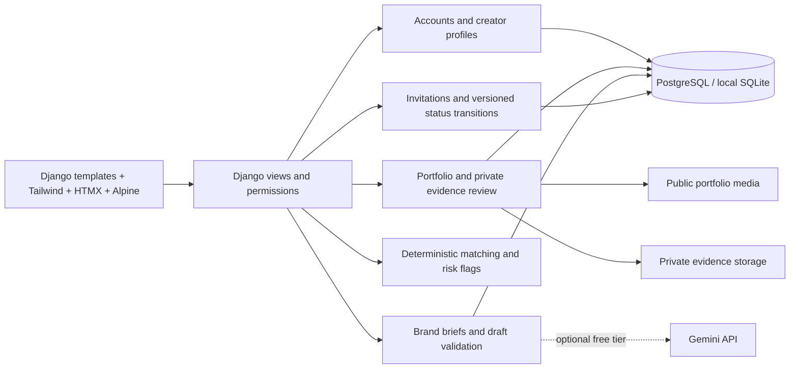

# CREO: a six-minute demo

## Prepare once

```sh
python manage.py migrate
python manage.py seed_demo
python manage.py createsuperuser
python manage.py runserver
```

Register your own brand and creator accounts through the UI. Keep them in separate browser profiles to avoid switching sessions during the demo. Seed accounts intentionally cannot log in. Give your real demo creator a profile and an original image or supported video link with accurate workflow/tool information; do not represent fictional seed artwork as genuine evidence.

For the brand you registered, run `python manage.py seed_showcase --brand YOUR_BRAND_USERNAME`. This adds two clearly labelled fictional briefs without overwriting edits or sending invitations. Their initial deadlines are 30 days from creation; update dates if reusing the demo later. No shared passwords or API keys are necessary.

## Presentation sequence

1. **0:00–0:45 — Portfolio first.** Open the landing page, browse the 14 fictional creators, and inspect a portfolio workflow. Point out format, aspect ratio, tools, and the honest demo labels.
2. **0:45–1:30 — A usable creative brief.** In the brand workspace, show a showcase brief or use the local brief builder. Explain that Gemini is optional; only demonstrate live Gemini after verifying your free-tier credentials.
3. **1:30–2:30 — Explainable discovery.** Open matches, inspect score components, and compare two creators. Show commercial-use caveats. Try an over-restrictive search and relax a suggested filter. Scores are capability overlap, not artistic quality or legal clearance.
4. **2:30–3:30 — Evidence with boundaries.** In your creator account, attach a screenshot or HTTPS proof link to a specific project claim. As a separate admin, review it with a rationale. Refresh the public project to show the signal; edit the project and show that approval becomes stale. Fictional seed work cannot receive Admin Reviewed status.
5. **3:30–5:00 — Close the loop.** From the brand's ready brief, invite your registered creator in the matches list. Confirm sharing the snapshot. In the creator's Engagements page, accept, start work, and submit an HTTPS link. The brand can request a revision or complete the engagement. Show the activity history and immutable scope snapshot.
6. **5:00–6:00 — Reliability and architecture.** Show the test result, local/no-key fallback, and architecture below. Clearly distinguish demonstrated behavior from configured-but-untested cloud deployment.

If the real creator is not the first match, use their profile name in discovery to check their capabilities, then locate them in the brief's ranked list. Matching does not exclude low-scoring active creators.

## Five-person presentation roles

- Presenter 1: user problem and positioning.
- Presenter 2: creator profile, portfolio, and evidence.
- Presenter 3: briefs and discovery scoring.
- Presenter 4: invitation workflow and the creator session.
- Presenter 5: tests, architecture, and deployment limitations.

## Architecture



`User → CreatorProfile → PortfolioItem → Evidence` models the creative work and review scope. `User → Brief → Engagement ← CreatorProfile` models a collaboration. Each engagement owns a copied brief snapshot and an append-only activity history through application routes. Tool, Skill, and Specialization remain normalized catalogs. No legal certification, identity verification, payment, or contract is implied by any status.
